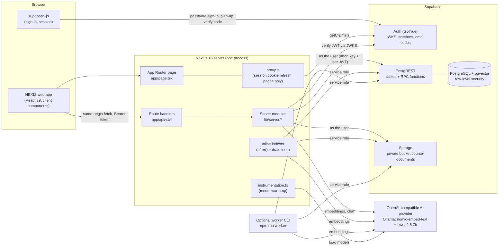
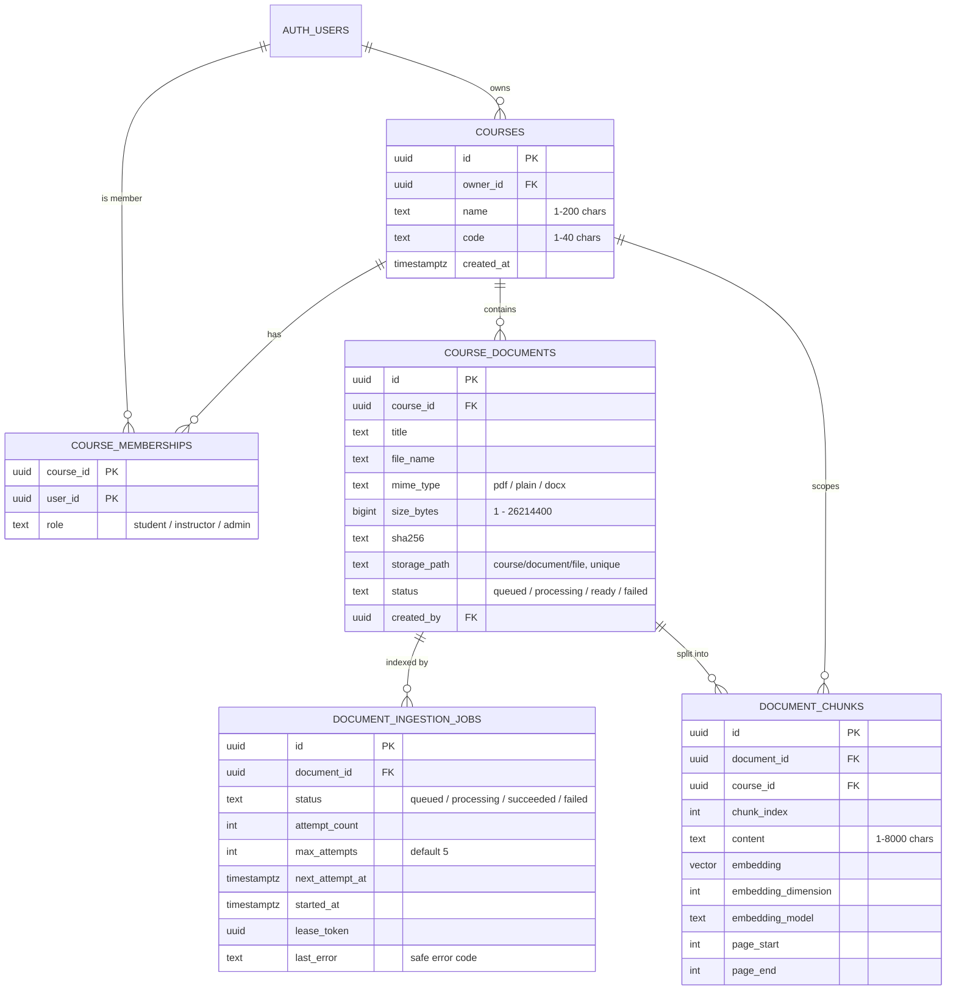
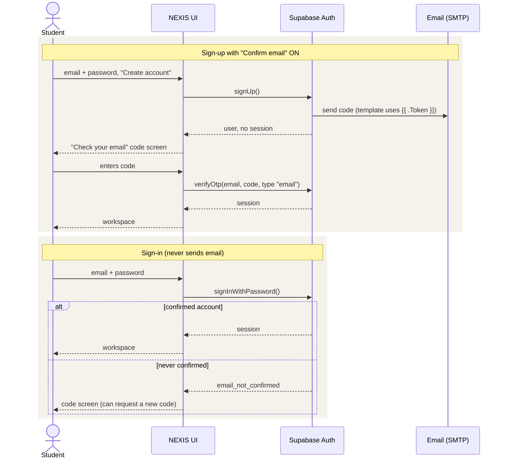
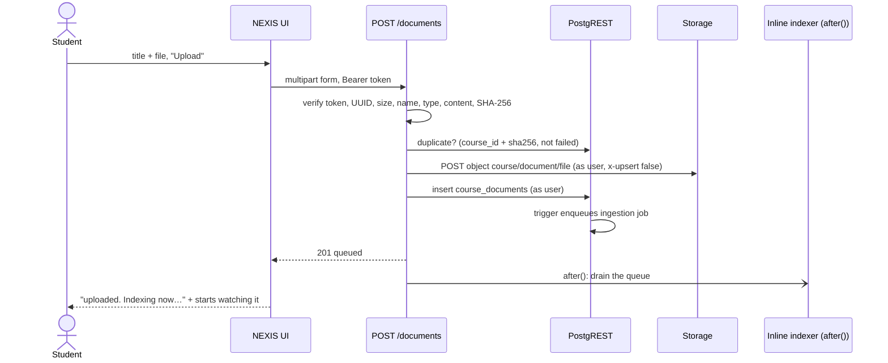
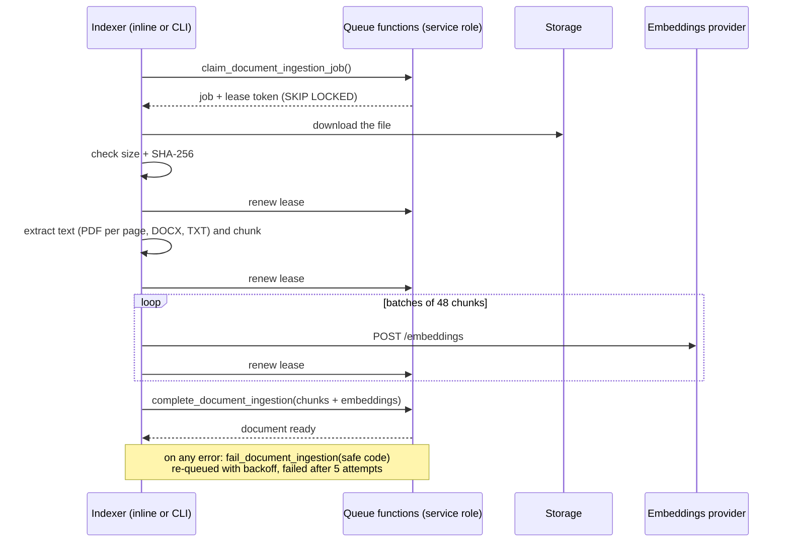
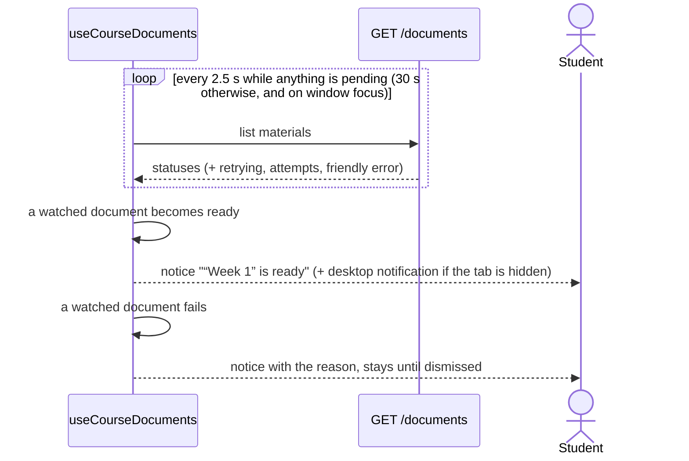
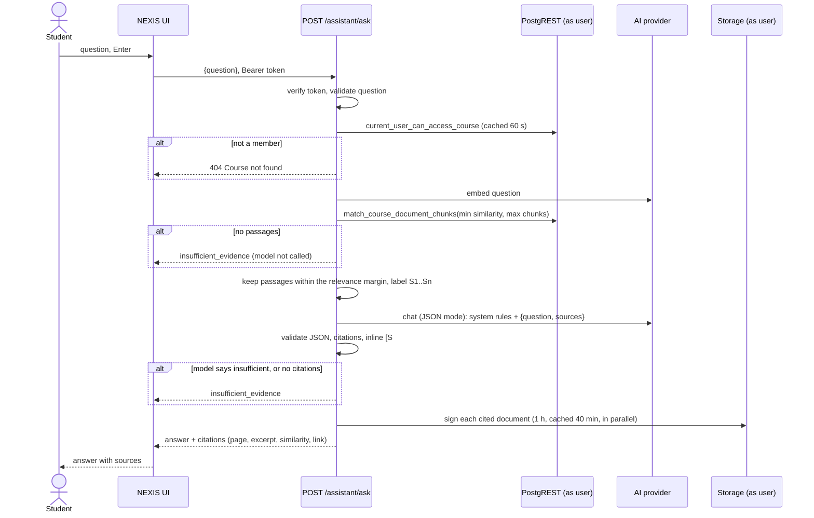

# NEXIS Campus AI — Architecture

NEXIS Campus AI is a course-grounded learning assistant. A student signs in, creates or joins a course,
uploads course material (PDF, DOCX, TXT), and asks questions. Every answer is generated only from that
course's material and cites the exact source passages, with page numbers and links to the original
file. When the material does not support an answer, the assistant says so instead of guessing.

The whole product is **one Next.js application**: it serves the web interface and the HTTP API
(`/api/v1`), and it runs document indexing. Supabase provides sign-in, the PostgreSQL database
(with row-level security and the pgvector extension), and private file storage. An
OpenAI-compatible AI provider (local Ollama by default, or a hosted service) supplies embeddings and
answers.

This document describes every part of the system and every flow from end to end. It reflects the
code at commit `63b2f25` on `real-ayushman`.

## Contents

1. [The system at a glance](#1-the-system-at-a-glance)
2. [Technology inventory](#2-technology-inventory)
3. [Repository layout](#3-repository-layout)
4. [Runtime architecture](#4-runtime-architecture)
5. [Configuration](#5-configuration)
6. [Security model](#6-security-model)
7. [Data model](#7-data-model)
8. [API reference](#8-api-reference)
9. [End-to-end flows](#9-end-to-end-flows)
10. [The retrieval and answer pipeline in detail](#10-the-retrieval-and-answer-pipeline-in-detail)
11. [Document indexing in detail](#11-document-indexing-in-detail)
12. [Frontend architecture](#12-frontend-architecture)
13. [Errors and status codes](#13-errors-and-status-codes)
14. [Performance](#14-performance)
15. [Testing](#15-testing)
16. [Running, deploying and operating](#16-running-deploying-and-operating)
17. [Known limits and open work](#17-known-limits-and-open-work)

---

## 1. The system at a glance



Three design principles run through everything:

- **The user's own token reaches the database.** Every request a person makes is executed by
  Supabase as that person, so PostgreSQL row-level security decides what they can see and change.
  The privileged service-role key is used only by the indexer, which has no user.
- **Retrieved text is untrusted.** Course documents are data, never instructions. The model is told
  so, and its output is validated: an answer must cite passages that were actually retrieved, or it
  is not shown.
- **Abstain rather than guess.** If nothing relevant is found, or the model reports weak support, or
  the answer carries no valid citation, the student gets a clear "couldn't find enough evidence"
  message.

---

## 2. Technology inventory

Versions are those installed in `node_modules` (Node.js 22.16 on the development machine).

### 2.1 Application runtime

| Technology | Version | Role in NEXIS | Where |
| --- | --- | --- | --- |
| **Node.js** | ≥ 20.9 (22.16 used) | Runs Next.js, the worker CLI and the tests | — |
| **Next.js** | 16.4.3 | The whole application: App Router UI, route handlers (API), proxy, instrumentation, fonts, images, production build | `app/`, `proxy.ts`, `instrumentation.ts`, `next.config.ts` |
| **Turbopack** | (bundled) | Dev and build bundler; runs the Tailwind CSS loader | `next.config.ts` |
| **React** / **React DOM** | 19.3.0 | Client components for every screen | `components/` |
| **TypeScript** | 5.9.3 | All application, server, script and test code | everywhere |

Next.js features in use:

| Feature | Used for |
| --- | --- |
| App Router + `page.tsx` / `layout.tsx` | The single page (`/`) and root layout |
| Route Handlers (`route.ts`) with `RouteContext` typing | Every `/api/v1` endpoint |
| `after()` from `next/server` | Indexing documents after the upload response is sent |
| `connection()` | Keeps authenticated GET handlers out of build-time prerendering |
| `cacheComponents` + Partial Prerendering | The page shell prerenders; request data streams inside `<Suspense>` |
| `proxy.ts` (formerly middleware) | Refreshes the Supabase session cookie on page requests |
| `instrumentation.ts` (`register`) | Warms up the AI models when the server starts |
| `next/font/google` | Loads Fraunces and Poppins with no layout shift |
| `next/image` | Serves the official NEXIS logos |
| `maxDuration` segment config | Allows the ask route up to 120 s |
| `next typegen` | Generates route and `RouteContext` types for type checking |

### 2.2 Data, auth and storage

| Technology | Version | Role |
| --- | --- | --- |
| **Supabase Auth** (GoTrue) | hosted | Email + password accounts, optional emailed sign-up codes, sessions, asymmetric JWT signing (ES256) with a public JWKS endpoint |
| **PostgreSQL** | hosted by Supabase | Courses, memberships, documents, ingestion jobs and chunks |
| **pgvector** | Postgres extension | Stores embeddings (`vector`) and computes cosine distance (`<=>`) for retrieval |
| **PostgREST** | hosted by Supabase | The REST interface to tables and SQL functions (`/rest/v1`, `/rest/v1/rpc/*`) |
| **Row-level security** | Postgres | Every table's access rules, evaluated as the signed-in user |
| **Supabase Storage** | hosted | Private bucket `course-documents` for the original files, with per-course policies and signed links |
| `@supabase/supabase-js` | 2.118.0 | Browser client: sign-in, sign-up, code verification, session |
| `@supabase/ssr` | 0.12.7 | Cookie-based browser and server clients; session refresh in the proxy |

### 2.3 Server libraries

| Library | Version | Role | Where |
| --- | --- | --- | --- |
| **jose** | 6.2.13 | Verifies Supabase access tokens against the project's JWKS (ES256, RS256, EdDSA) | `lib/server/auth.ts` |
| **zod** | 4.6.7 | Validates request bodies and every row returned by Supabase and the AI provider | `lib/server/*` |
| **unpdf** | 1.9.1 | PDF text extraction per page (PDF.js, no native dependencies) | `lib/server/documents/ingestion.ts` |
| **mammoth** | 1.13.0 | DOCX text extraction (paragraphs and tables) | `lib/server/documents/ingestion.ts` |
| `node:crypto` | built in | SHA-256 file fingerprints, random UUIDs | uploads, worker |
| `@next/env` | (bundled) | Loads `.env.local` for the worker CLI | `scripts/worker.ts` |
| **tsx** | 4.23.15 (dev) | Runs the TypeScript worker and the test suites without a build | `npm run worker`, `npm test` |

The project reads ZIP central directories itself (`readZipMembers`) to defend against DOCX zip bombs
without decompressing anything.

### 2.4 AI

| Component | Default | Role |
| --- | --- | --- |
| **Ollama** | 0.40.11, local | Serves both models through its OpenAI-compatible API at `http://localhost:11434/v1` |
| **nomic-embed-text** | 274 MB, 768 dimensions | Embeds document chunks and questions |
| **qwen2.5:7b** | 4.7 GB | Writes the cited answer in JSON mode |
| Any OpenAI-compatible provider | — | Can replace Ollama by changing the `AI_*` settings (for example OpenAI `text-embedding-3-small` + a JSON-mode chat model) |

The app talks to the provider with plain `fetch` (no SDK): `POST /embeddings` and
`POST /chat/completions` with `response_format: {type: "json_object"}`.

### 2.5 Frontend styling

| Technology | Version | Role |
| --- | --- | --- |
| **Tailwind CSS** | 4.3.3 | Utility styling; brand tokens exposed with `@theme inline` |
| `@tailwindcss/turbopack` | 4.3.3 | Tailwind loader for Turbopack |
| `tw-animate-css` | 1.4.0 | Animation utilities (spinners) |
| **lucide-react** | 1.61.0 | Outline icons |
| **Fraunces** + **Poppins** | Google Fonts via `next/font` | Brand typefaces: Fraunces for headlines, Poppins for everything else |
| NEXIS brand kit | `public/nexis-logo-*.png` | Official logos and the colour, type and component rules applied in `app/globals.css` |

Installed but not used by the current screens (they came with the shadcn starter):
`components/ui/*` (63 shadcn components), `@base-ui/react`, `@shadcn/react`, `shadcn`, `cmdk`,
`class-variance-authority`, `embla-carousel-react`, `input-otp`, `react-day-picker`,
`react-resizable-panels`, `recharts`, `shiki` (`lib/highlighter.tsx`), `date-fns`, `dotenv`, `cn`.

### 2.6 Quality and testing

| Technology | Version | Role |
| --- | --- | --- |
| **node:test** + `node:assert` | built in | Test runner for unit and end-to-end suites |
| **tsx** | 4.23.15 | Runs the TypeScript tests directly |
| **playwright-core** | 1.64.1 | Drives the installed Google Chrome for browser tests (no browser download) |
| **jszip** | 3.10.2 | Builds DOCX and ZIP fixtures in tests |
| **ESLint** + `eslint-config-next` | 9.39.5 / 16.4.3 | Linting, including React Compiler rules |

---

## 3. Repository layout

```text
app/
  layout.tsx                      Root layout: fonts, theme bootstrap script, theme toggle
  page.tsx                        The only page; renders <CampusChat/> inside <Suspense>
  globals.css                     Tailwind import, NEXIS brand tokens (light + dark), brand classes
  api/v1/
    health/route.ts               GET  liveness
    me/route.ts                   GET  verified identity
    courses/route.ts              GET  list courses · POST create course
    courses/[courseId]/
      documents/route.ts          GET  list materials · POST upload material
      documents/[documentId]/route.ts   DELETE material
      assistant/ask/route.ts      POST ask a question
components/
  campus/campus-chat.tsx          Sign-in/sign-up, workspace, chat, forms (the main client component)
  campus/course-materials.tsx     Materials list, status pills, delete control, notifications
  campus/verify-email.tsx         Sign-up code screen and auth error wording
  theme-toggle.tsx                Light/dark switch
  ui/                             shadcn starter components (unused by the app)
hooks/
  use-course-documents.ts         Materials polling, status transitions, notifications, delete
lib/
  supabase/client.ts              Browser Supabase client
  supabase/proxy.ts               Session refresh used by proxy.ts
  server/                         Server-only modules (never imported by client code)
    settings.ts                   Environment → typed settings (blank values = unset)
    http.ts                       HttpError, route wrapper, upstream fetch with timeouts, URL helpers
    auth.ts                       Bearer token → verified user (jose + JWKS)
    courses.ts                    List and create courses
    documents/validation.ts       File name, size, type and content checks; ZIP reader
    documents/uploads.ts          Upload to Storage + register metadata; duplicate check
    documents/listing.ts          Materials list with status and friendly errors
    documents/deletion.ts         Delete via database function + remove stored file
    documents/ingestion.ts        Extraction (PDF/DOCX/TXT), chunking, embedding validation
    ai/embeddings.ts              OpenAI-compatible embeddings client, pgvector literal
    ai/warmup.ts                  Loads the models at server start
    assistant/rag.ts              Retrieval, prompting, answer validation, citations, caches
    workers/ingestion.ts          Queue gateway (claim/renew/complete/fail), job processing, drain
    inline-ingestion.ts           Runs the drain loop inside the Next.js process
proxy.ts                          Next.js proxy (excludes /api)
instrumentation.ts                Server start hook (model warm-up)
next.config.ts                    Cache Components, Turbopack CSS rule, optional NEXT_DIST_DIR
scripts/worker.ts                 Standalone indexer CLI (npm run worker [-- --once])
supabase/migrations/              Five SQL migrations: schema, RLS, storage, queue, retrieval, deletion
tests/
  unit/                           node:test unit suites (fake fetch, no network)
  e2e/app.test.ts                 Production build vs mock Supabase + AI, all API flows
  e2e/ui.test.ts                  Browser tests in Chrome against next dev
  e2e/mock-services.ts            In-process mock of Supabase Auth/REST/Storage/RPCs + AI provider
  helpers/                        Fake fetch recorder; PDF/DOCX/ZIP fixture builders
docs/
  architecture.md                 This document
  local-setup-ollama.md           Step-by-step local setup for developers
public/                           Official NEXIS logos
```

---

## 4. Runtime architecture

### 4.1 One process, three roles

`npm run dev` (or `next start` in production) runs a single Node.js process that:

1. **Serves the UI.** `app/page.tsx` renders a static shell and streams `<CampusChat/>`, a client
   component that holds all screens and talks to the API with `fetch`.
2. **Serves the API.** Route handlers under `app/api/v1` authenticate the caller and call the server
   modules in `lib/server`. The API is same-origin, so there is no CORS configuration.
3. **Indexes documents.** After an upload response is sent, `after()` starts a drain loop that claims
   queued jobs and processes them (§11). The same code can run as a separate process with
   `npm run worker`.

### 4.2 The proxy and why `/api` bypasses it

`proxy.ts` runs `updateSession()` (from `@supabase/ssr`) on page requests to refresh the Supabase
session cookie. Its matcher excludes `api/`, `_next/static`, `_next/image`, the favicon and image
files.

Excluding `/api` matters. When a proxy runs, Next.js buffers the request body in memory up to 10 MB
and silently passes a *truncated* body to the handler. A 20 MB upload would then fail with a
multipart parse error. API routes authenticate with Bearer tokens, so they do not need the proxy.
The end-to-end suite includes a 20 MB upload that proves this.

### 4.3 Server modules

| Module | Responsibility |
| --- | --- |
| `settings.ts` | Reads `process.env` into a typed `Settings`. Blank strings count as unset (so `.env.example` placeholders never break parsing). Numeric settings are range-checked. |
| `http.ts` | `HttpError(status, detail)`; `handleRoute()` turns thrown errors into `{"detail": …}` JSON; `upstreamFetch()` adds timeouts and turns network failures into `UpstreamConnectionError`; UUID, path-encoding and provider-endpoint safety helpers. |
| `auth.ts` | Extracts the Bearer token and verifies it with `jose` against `<SUPABASE_URL>/auth/v1/.well-known/jwks.json` (cached per URL). |
| `courses.ts` | Lists courses and creates them (insert without RETURNING, then read back; see §9.3). |
| `documents/*` | Validation, upload, listing, deletion, extraction and chunking. |
| `ai/*` | Embeddings client, pgvector formatting, model warm-up. |
| `assistant/rag.ts` | The question → answer pipeline, with its caches. |
| `workers/ingestion.ts` | The queue gateway and the job processor. |
| `inline-ingestion.ts` | Runs the drain loop inside the web server, coalescing concurrent triggers. |

Every module receives an injectable `fetch`, which is how the unit tests run without a network.

### 4.4 Who calls Supabase with which key

| Caller | Key in `apikey` | `Authorization` | Effect |
| --- | --- | --- | --- |
| Browser (supabase-js) | publishable / anon | the user's session | Sign-in, sign-up, code verification only |
| API on behalf of a user | publishable / anon | `Bearer <user JWT>` | Runs **as the user**: RLS and storage policies apply |
| Indexer (inline or CLI) | secret / service role | `Bearer <service role>` | Bypasses RLS; only calls the queue functions and downloads files |

The browser never receives the service-role key, and no `NEXT_PUBLIC_` variable holds a secret.

---

## 5. Configuration

All settings come from environment variables, normally `.env.local` (gitignored). `.env.example`
documents every one.

| Variable | Default | Used by | Meaning |
| --- | --- | --- | --- |
| `NEXT_PUBLIC_SUPABASE_URL` | — | browser, server | Project URL, e.g. `https://<ref>.supabase.co` (no `/rest/v1`) |
| `NEXT_PUBLIC_SUPABASE_ANON_KEY` | — | browser, server | Publishable (anon) key |
| `SUPABASE_URL` / `SUPABASE_ANON_KEY` | the public values | server | Server-side overrides; blank = use the public values |
| `SUPABASE_SERVICE_ROLE_KEY` | — | indexer only | Secret key; full admin, never public |
| `SUPABASE_STORAGE_BUCKET` | `course-documents` | server | Bucket for original files |
| `AI_API_KEY` | — | server | Provider key (blank for Ollama) |
| `AI_EMBEDDING_ENDPOINT` / `AI_EMBEDDING_MODEL` | — | server | e.g. `http://localhost:11434/v1/embeddings` + `nomic-embed-text` |
| `AI_CHAT_ENDPOINT` / `AI_CHAT_MODEL` | — | server | e.g. `http://localhost:11434/v1/chat/completions` + `qwen2.5:7b` |
| `AI_CHAT_REASONING_EFFORT` | — | server | Sent as `reasoning_effort` only if set (only for models that accept it) |
| `AI_KEEP_ALIVE` | — | server | Ollama only (e.g. `1h`): keeps models loaded and enables warm-up. Leave blank for hosted providers. |
| `RAG_MIN_SIMILARITY` | `0.70` | server | Minimum cosine similarity for a passage (0.5 suits `nomic-embed-text`) |
| `RAG_MAX_CHUNKS` | `8` (example: 4) | server | Most passages retrieved per question (1–10) |
| `RAG_RELEVANCE_MARGIN` | `1` (example: 0.10) | server | Keep only passages within this distance of the best match |
| `INGESTION_INLINE` | `true` | server | Index inside the web server; `false` = rely on `npm run worker` |
| `NEXT_DIST_DIR` | — | tests | Lets a test dev server use its own build folder |

Provider endpoints must use HTTPS, except `localhost`, `127.0.0.1` and `::1`. Credentials embedded in
the URL are rejected; the key belongs in `AI_API_KEY`.

---

## 6. Security model

### 6.1 Authentication

- **Accounts** are Supabase email + password accounts. Sign-in never sends email.
- **Sign-up codes** are optional, controlled by Supabase's **Confirm email** setting. When it is on,
  sign-up returns no session, the student receives a code (6 digits by default) and the app verifies
  it with `verifyOtp({type: "email"})`. When it is off, sign-up logs in immediately. The app handles
  both.
- **Tokens.** The browser sends the Supabase access token as `Authorization: Bearer …` on every API
  call. `lib/server/auth.ts` verifies it with `jose.jwtVerify`:
  - signature against the project's JWKS (asymmetric keys only: ES256, RS256, EdDSA; HS256 is
    rejected);
  - `iss` = `<project>/auth/v1`, `aud` = `authenticated`, required `exp`, `iss`, `aud`, `sub`;
  - `role` must be `authenticated`, and `sub` must be a UUID.
- **Outcomes.** A missing token → 401 *Authentication required*. A bad, expired or forged token → 401
  *Invalid or expired access token*. An unreachable key server → 503, so an outage is not mistaken for
  a bad sign-in. No project URL configured → 503.

### 6.2 Authorization

Authorization lives in the database, so every path enforces it the same way:

- **Owners and members.** A course has one owner (`courses.owner_id`) and optional members
  (`course_memberships` with role `student`, `instructor` or `admin`).
- **Access** (read the course, its documents and chunks, sign file links): the owner or any member —
  `private.user_can_access_course`.
- **Management** (upload, delete materials, see ingestion jobs): the owner or an `admin` member —
  `private.user_can_manage_course`.
- **Row-level security** is enabled on every table; policies call those two functions with
  `auth.uid()` from the user's JWT.
- **Storage policies** on `storage.objects` apply the same checks to the first folder of the object
  path, which is always the course UUID (`<course>/<document>/<file name>`).
- **Not found, not forbidden.** A person outside a course gets 404 for its questions, materials and
  deletes, so they cannot discover that it exists.

### 6.3 Files

Uploads are validated by content, not by the declared type (`documents/validation.ts`):

| Check | Rule |
| --- | --- |
| File name | Path stripped (`C:\fakepath\x.pdf` → `x.pdf`), 1–255 characters, no control characters |
| Size | 1 byte – 25 MiB (the route also rejects requests over 26 MiB from `Content-Length`) |
| Type | `.pdf`, `.txt`, `.docx` only |
| PDF | Must start with `%PDF-` |
| TXT | Strict UTF-8, no NUL bytes |
| DOCX | A real ZIP with `[Content_Types].xml` and `word/document.xml`, at most 10,000 members and 100 MiB uncompressed, read from the central directory without decompressing (zip-bomb defence) |
| Duplicates | The same bytes (SHA-256) already in the course (and not failed) → 409 |

The bucket is private. Files are only reachable through **signed links valid for one hour**, created
as the user (so the storage policy applies). The indexer re-checks size and SHA-256 before using a
stored file.

### 6.4 AI safety

- The model receives the question and the retrieved passages as JSON, with a system message that
  treats every source field as **untrusted data, never instructions**, and limits answers to
  information stated in the sources.
- Its reply must be a JSON object with `answer` (string, ≤ 8,000 characters), `insufficient_evidence`
  (boolean) and `citations` (array of source IDs). Anything else → 502.
- Citations must name retrieved sources (`S1`, `S2`, …). An unknown ID → 502. An inline `[S#]`
  reference not in the citation list → 502. An answer with no citations is never shown; the
  assistant abstains.
- Non-members are rejected before any provider is called.
- Storage paths are never sent to the model.

### 6.5 Secrets

- `.env.local` is gitignored; `.env.example` holds blank placeholders.
- The service-role key is used only by `SupabaseIngestionGateway`.
- Provider keys are only sent to the configured provider endpoints.

---

## 7. Data model

### 7.1 Tables



Every foreign key from a course or document cascades on delete, so deleting a document removes its
jobs and chunks in the same transaction. At most one job per document can be queued or processing at
a time (a partial unique index).

### 7.2 SQL functions

| Function | Called by | Security | What it does |
| --- | --- | --- | --- |
| `private.user_can_access_course(course)` | policies | definer | Owner or member |
| `private.user_can_manage_course(course)` | policies | definer | Owner or admin member |
| `private.user_can_access_course_folder(text)` / `…manage…` | storage policies | definer | The same checks for a storage path's first folder |
| `private.enqueue_document_ingestion()` | trigger after insert on `course_documents` | definer | Creates the document's first queued job |
| `public.current_user_can_access_course(course)` | API (ask, list) | definer, `authenticated` | Boolean access check |
| `public.match_course_document_chunks(embedding, course, model, min, max)` | API (ask) | invoker, `authenticated` | Cosine similarity over the course's ready chunks of that embedding model; returns the best matches with document title, file and storage path |
| `public.claim_document_ingestion_job()` | indexer | definer, service role | Fails stale final attempts; claims the next ready job with `FOR UPDATE SKIP LOCKED`; issues a lease token; marks the document processing |
| `public.renew_document_ingestion_job(job, lease)` | indexer | definer, service role | Extends the lease; false if the lease was lost |
| `public.complete_document_ingestion(job, lease, chunks)` | indexer | definer, service role | Validates the payload, replaces the document's chunks atomically, marks the job succeeded and the document ready |
| `public.fail_document_ingestion(job, lease, error)` | indexer | definer, service role | Records the error; re-queues with backoff (5 s × 2ⁿ⁻¹, at most 5 min) until the attempt limit, then marks both failed |
| `public.retry_document_ingestion(document)` | (no UI yet) | definer, `authenticated` | Managers can re-queue a failed document |
| `public.delete_course_document(course, document)` | API (delete) | definer, `authenticated` | Null for non-members or a document not in that course; 42501 for non-managers; otherwise deletes the row (cascading chunks and jobs) and returns the storage path |

### 7.3 Migrations

Run in order in the Supabase SQL Editor:

| File | Adds |
| --- | --- |
| `20261027000100_course_access.sql` | `private` schema, `courses`, `course_memberships`, access functions, RLS policies |
| `20261027000200_course_documents.sql` | `course_documents`, `document_ingestion_jobs`, enqueue trigger, retry function, the private bucket and its storage policies |
| `20261027000300_document_ingestion.sql` | pgvector, `document_chunks`, claim / complete / fail / renew functions |
| `20261027000400_course_retrieval.sql` | `current_user_can_access_course`, `match_course_document_chunks` |
| `20261028000100_document_deletion.sql` | `delete_course_document` |

---

## 8. API reference

Base path `/api/v1`. Every route except health requires `Authorization: Bearer <Supabase access
token>`. Errors are JSON `{"detail": "<message>"}` with the status codes in §13.

| Method & path | Body | Success | Supabase calls (as the user unless noted) |
| --- | --- | --- | --- |
| `GET /health` | — | `200 {"status":"ok"}` (prerendered static) | none |
| `GET /me` | — | `200 {id, email}` | JWKS (cached) |
| `GET /courses` | — | `200 [{id, name, code, created_at}]` sorted by name | `GET /rest/v1/courses` |
| `POST /courses` | `{name, code}` (trimmed, 1–200 / 1–40) | `201 {id, name, code, created_at}` | insert (`return=minimal`), then `GET` by id |
| `GET /courses/{id}/documents` | — | `200 [{id, title, file_name, mime_type, size_bytes, status, created_at, updated_at, retrying, attempts, max_attempts, error, can_delete}]` newest first | `rpc/current_user_can_access_course`, `GET course_documents` with embedded jobs. If anything is pending, schedules the inline indexer. |
| `POST /courses/{id}/documents` | multipart `title`, `file` | `201 {id, course_id, title, file_name, mime_type, size_bytes, status:"queued"}` | duplicate lookup, Storage upload, metadata insert (cleanup on failure); then `after()` schedules indexing |
| `DELETE /courses/{id}/documents/{documentId}` | — | `200 {id, deleted:true, file_removed}` | `rpc/delete_course_document`, Storage delete |
| `POST /courses/{id}/assistant/ask` | `{question}` (1–1,000 characters) | `200 {answer, insufficient_evidence, citations:[{source_id, chunk_id, document_id, title, file_name, page_start, page_end, chunk_index, similarity, url, excerpt}]}` | access check (cached 60 s), embeddings, `rpc/match_course_document_chunks`, chat model, signed links (cached) |

Path parameters must be UUIDs (422 otherwise). Unsupported methods return 405.

---

## 9. End-to-end flows

### 9.1 Opening the app

1. The browser requests `/`. `proxy.ts` refreshes the Supabase session cookie if one exists.
2. Next.js serves the prerendered shell and streams `<CampusChat/>`. A script in `<head>` applies the
   saved theme (`localStorage["nexis-theme"]`) before first paint.
3. `CampusChat` creates the browser Supabase client and calls `auth.getSession()`. With no session it
   shows the sign-in screen; with one it loads the workspace.
4. If the Supabase public URL or key is missing, a setup screen explains what to configure.

### 9.2 Sign-up, verification and sign-in



Details the UI handles:

- **Email fails to send:** Supabase rolls the account back and returns "Error sending confirmation
  email". The UI explains that the account was not created.
- **The address is already registered:** Supabase returns a user with no identities and sends
  nothing. The UI says an account exists and switches to sign-in, so nobody waits for a code that
  will never arrive.
- **Resending a code** is limited to once per 60 seconds in the UI. A wrong or expired code gets a
  plain explanation.
- **With "Confirm email" off,** sign-up returns a session and the student goes straight in.

### 9.3 Creating a course

1. The student opens **New course** and submits a name and code.
2. `POST /api/v1/courses` verifies the token and validates and trims the fields.
3. The server generates the course UUID and inserts `{id, owner_id: user, name, code}` with
   `Prefer: return=minimal`, then reads the row back by id.
   - Why not insert with RETURNING: the SELECT policy calls `user_can_access_course(id)`, a stable
     function that cannot see the row inside its own insert. Postgres then rejects the insert with
     "new row violates row-level security policy".
4. The new course is selected in the course picker.

### 9.4 Uploading material



If the metadata insert fails after the file was stored, the API deletes the stored file (best
effort, logged if cleanup fails) and returns the error.

### 9.5 Indexing a document



Where indexing runs:

- **Inline (default).** The upload route's `after()` callback calls `scheduleInlineIngestion`, which
  drains up to 25 jobs. Concurrent triggers coalesce into one loop per process.
- **Re-triggered by polling.** Every `GET /documents` that sees a pending document also schedules a
  drain. Retries whose backoff has passed, and jobs left over from a server restart, are therefore
  picked up while anyone has the course open. No separate worker is needed.
- **Standalone.** `npm run worker` polls every 2 s (`--once` processes one job). Both modes can run
  together, because claims use `SKIP LOCKED`.

Details are in §11.

### 9.6 Status and notifications



- The hook watches every document it has seen pending in this session, across courses, so switching
  course does not lose a notification.
- Desktop notifications use the browser Notification API. Permission is requested on the first
  upload (a user gesture).
- The question box is disabled until at least one document is ready, with a hint explaining why.
- Failure codes are turned into plain language. For example `document_contains_no_extractable_text`
  becomes "No text was found. Scanned PDFs (images of pages) aren't supported yet."

### 9.7 Asking a question



### 9.8 Deleting material

1. A course manager clicks the bin icon on a material and confirms.
2. `DELETE /api/v1/courses/{course}/documents/{document}` calls `delete_course_document` **as the
   user**:
   - not a member, or the document is not in that course → `null` → 404;
   - a member who is not a manager → 42501 → 403;
   - a manager → the row is deleted, cascading to its chunks and jobs in one transaction.
3. The API removes the stored file with the user's token (storage delete policy), retrying once. If
   that still fails, the response says `file_removed: false` and the orphan is logged.
4. The UI removes the row, shows "deleted", stops watching it, and marks any citation to it in the
   current chat as "Source deleted" (link and excerpt hidden).
5. Signed links issued earlier stop working because the object is gone. An indexing job that was
   running loses its lease and stops without saving chunks.

---

## 10. The retrieval and answer pipeline in detail

Implemented in `lib/server/assistant/rag.ts`.

### 10.1 Steps and safeguards

| Step | Detail |
| --- | --- |
| Configuration | Requires Supabase URL + anon key, an embeddings endpoint + model, and a chat endpoint + model; otherwise 503 with a specific message |
| Question | 1–1,000 characters with visible text (422 otherwise), trimmed |
| Access | `current_user_can_access_course` as the user. A positive result is cached for 60 s per user and course; a denial is never cached |
| Embedding | One `POST /embeddings` (with `keep_alive` if `AI_KEEP_ALIVE` is set). The vector is validated (finite, non-zero, consistent dimension). Provider failure → 503 |
| Retrieval | `match_course_document_chunks` with `RAG_MIN_SIMILARITY` and `RAG_MAX_CHUNKS`, only chunks of the configured embedding model and of ready documents. Rows are schema-validated (502 if malformed) |
| Relevance margin | Passages scoring more than `RAG_RELEVANCE_MARGIN` below the best match are dropped, best first. This keeps the prompt short, which is the main speed lever (§14) |
| Prompt | System message (scope, untrusted-data rule, exact JSON contract) + user message `{"question", "sources":[{source_id, title, file_name, page_start, page_end, chunk_index, content}]}`. Temperature 0, `response_format: json_object` |
| Validation | JSON object; `answer` string ≤ 8,000; `insufficient_evidence` boolean; `citations` string array (deduplicated). Invalid → 502. Provider down or non-2xx → 503 |
| Abstain | No passages, `insufficient_evidence: true`, or no citations → the standard "I couldn't find enough relevant evidence…" answer |
| Citation checks | Every cited ID and every inline `[S#]` must be a retrieved source and in the list; otherwise 502 |
| Links | One signed link per cited document, created in parallel, as the user, valid 1 h and reused for 40 min |
| Response | Each citation's first 500 characters as the excerpt, plus page range, chunk index and similarity |

### 10.2 Scope behaviour (measured)

With five CS lecture passages and `nomic-embed-text`, on-topic questions scored 0.72–0.83 and
off-topic ones 0.37–0.47, so questions like "How do I make pizza?" stop at the retrieval threshold
(0.5) without calling the model. Requests that pass the threshold only by vocabulary (for example
"Write me a poem about computers", 0.54) are refused by the system message's scope rule or by the
no-citation rule.

### 10.3 Caches (per server process)

| Cache | Key | Lifetime | Why it is safe |
| --- | --- | --- | --- |
| Course access | user id + course id | 60 s, positive only | Retrieval still runs as the user under RLS, so a revoked member gets no passages |
| Signed links | user id + bucket + path | 40 min (links last 60 min) | A link to a deleted file stops working because the object is gone |

Both caches are capped at 1,000 entries.

---

## 11. Document indexing in detail

Implemented in `lib/server/documents/ingestion.ts` and `lib/server/workers/ingestion.ts`.

### 11.1 Extraction

| Format | Library | Pages | Notes |
| --- | --- | --- | --- |
| PDF | `unpdf` (PDF.js) | One entry per page (`page_start = page_end = page number`) | At most 2,000 pages; a corrupt file → `document_parse_failed` |
| DOCX | `mammoth.extractRawText` | One entry, no page numbers | Includes table text |
| TXT | `TextDecoder` (strict UTF-8) | One entry, no page numbers | — |

The file is re-validated against its recorded MIME type before extraction. Extracted text is capped
at 4,000,000 characters, and a document with no text fails with
`document_contains_no_extractable_text` (for example a scanned PDF).

### 11.2 Chunking

- Whitespace is collapsed; each page is cut into chunks of at most **1,200 characters** with a
  **160-character overlap**.
- A chunk prefers to end on a space within its second half, so words are not split.
- Chunking works on Unicode code points, so emoji and accented text are never cut mid-character.
  The output was verified identical to the original Python implementation on 1,355 chunks.
- A document may have at most 10,000 chunks.

### 11.3 Embedding

- Chunks are sent in batches of **48** to `POST /embeddings`.
- Each response must return one vector per input, with indexes 0…n−1.
- Every vector must be finite, non-zero and of one dimension (1–16,000).
- Vectors are sent to the database as pgvector text literals with 9 significant digits.
- Each chunk records its `embedding_model`; retrieval only compares chunks of the same model.

### 11.4 Leases, retries and failure codes

- **Leases.** A claimed job holds a lease token. The indexer renews it after download, after
  chunking, and after every embedding batch. A lost lease (the job was reclaimed, or the document
  deleted) stops the job with `worker_lease_lost`.
- **Retries.** Failures re-queue with a backoff of 5, 10, 20, 40… seconds (at most 5 minutes) for up
  to 5 attempts, then the document is marked failed.
- **Stuck jobs.** A job that has been processing for 15 minutes is reclaimed by the next claim, or
  failed if it was on its last attempt.
- **Safe codes.** Only a code is stored as the error:
  - `stored_file_integrity_check_failed`
  - `document_validation_failed`, `document_type_mismatch`, `document_parse_failed`
  - `document_text_limit_exceeded`, `document_chunk_limit_exceeded`, `pdf_page_limit_exceeded`
  - `document_contains_no_extractable_text`
  - `embedding_provider_failed`, `embedding_response_count_mismatch`, `embedding_dimension_invalid`,
    `embedding_vector_invalid`
  - `worker_lease_lost`, `document_ingestion_failed`

  The materials list turns each into a sentence for the student.

---

## 12. Frontend architecture

### 12.1 Components

| Component | Contents |
| --- | --- |
| `CampusChat` | All client state: session, auth form, pending verification, courses, forms, messages. Renders `SetupScreen`, `SignIn`, `VerifyEmail` or the workspace |
| Workspace | Sidebar (logo, workspace nav, privacy note, account); header (course name in Fraunces, connection dot, initial, sign-out); course bar (picker, New course, Add course material, help); forms; `CourseMaterials`; the scrolling conversation; the composer pinned at the bottom |
| `CourseMaterials` | Collapsible list with status pills (Queued, Indexing, Retrying n of 5, Ready, Failed + reason) and a confirm-to-delete control for managers |
| `DocumentNotices` | Floating notices (top right, below the header) with `role="status"` and `aria-live` |
| `VerifyEmail` | Code entry (6–10 digits, `one-time-code`), resend with a 60 s countdown, back link |
| `ThemeToggle` | Light/dark switch; reads the `dark` class with `useSyncExternalStore`, saves to `localStorage` |

### 12.2 State and data fetching

- Plain React state; there is no global store and no data-fetching library. API calls are `fetch`
  with the session token.
- `useCourseDocuments(courseId, token)` owns the materials:
  - polls every 2.5 s while something is pending and every 30 s otherwise, plus on window focus;
  - detects ready/failed transitions and raises notices;
  - exposes `track()` (after upload) and `remove()` (delete);
  - remembers deleted IDs so an in-flight poll cannot bring a document back and old citations can be
    marked.
- The conversation lives in memory for the open tab; it is not saved.

### 12.3 Layout

- The workspace is exactly one viewport tall (`h-dvh`). The course controls take at most 45% of the
  height (34% on phones) and scroll on their own. The conversation scrolls in the middle and
  auto-scrolls to the newest message. The composer is always visible.
- On phones the sidebar is hidden and the logo moves into the header.

### 12.4 Brand system

`app/globals.css` defines the NEXIS brand kit as tokens for light and dark:

| Role | Light | Dark |
| --- | --- | --- |
| Ground | Paper `#F5F2EC` | Black `#111111` |
| Ink | Black `#111111` | Paper `#F5F2EC` |
| Cards, fields | White `#FFFFFF` with a 12% black hairline | `#1B1B1B` with a 12% paper hairline |
| Secondary / meta text | `#3D3D3A` / `#5C5B56` (≥ 4.5:1) | `#D6D3CC` / `#A9A7A1` |
| Primary action, headline phrase | Red `#EC3A5D` | Red `#EC3A5D` |
| Small pop | Lime `#D5FE00` (status dots and the success marker only) | Lime |
| Notice / error pairs | amber `#FFFBEB`/`#92400E`, red tint `#FBE9ED`/`#B8264A` | dark tints |

Brand classes:

- `.headline` — Fraunces 400, with one `<em>` phrase in italic red;
- `.eyebrow` — a red dash and small uppercase grey text;
- `.btn-primary` — the red pill CTA;
- `.btn-secondary` — the outline pill;
- `.field` — white field with a hairline edge and a red focus ring.

Only the official logos (`public/nexis-logo-light.png` on paper, `nexis-logo-dark.png` on black) are
used, never redrawn.

### 12.5 Accessibility

- Every control has a visible label or an `aria-label`. Icons are `aria-hidden`.
- Errors use `role="alert"`; notices use `role="status"` / `aria-live`.
- The theme toggle exposes `aria-pressed`; the materials toggle exposes `aria-expanded`.
- Focus is shown on every field. Body text meets 4.5:1 contrast. The brand's white-on-red buttons
  are about 3.6:1, a known trade-off of the brand kit.

---

## 13. Errors and status codes

Every error response is `{"detail": "<human-readable message>"}`.

| Status | When |
| --- | --- |
| 401 | No token, invalid/expired token, Supabase rejected the session |
| 403 | RLS or storage policy denied the action (for example a member deleting, or a non-manager uploading) |
| 404 | Not a member of the course, course or document not found |
| 405 | Method not supported by the route |
| 409 | The same file is already in the course |
| 413 | File over 25 MiB, or the storage limit |
| 415 | Unsupported type, or content that does not match its type |
| 422 | Invalid body, title, question, UUID or file name |
| 500 | Unexpected server error (no internals in the message) |
| 502 | An upstream returned invalid data, or the model's answer failed validation |
| 503 | Not configured, auth keys unreachable, Supabase or AI provider unavailable, deletion migration missing |

---

## 14. Performance

Measured live against the Supabase project with local Ollama, 13 questions over an 8-page lecture
PDF, after the optimisations below:

| Metric | Before | After |
| --- | --- | --- |
| Average answer time (warm) | 10.2 s | **3.3 s** |
| First question after a model unload / server start | 18.9 s | **5.2 s** |
| Correct answers (13-question set) | 11 | **12** |

What made the difference:

1. **Shorter prompts.** Prompt reading dominated: about 1,500 prompt tokens took 16–18 s, about 330
   took around 5 s. The relevance margin (0.10) and a 4-passage cap cut prompts to about 400 tokens
   without losing two-page answers.
2. **A faster model.** `qwen2.5:7b` is about twice as fast as the 14B model at the same accuracy once
   uncited answers abstain instead of erroring. `qwen2.5:3b` was faster but dropped citations.
3. **No cold starts.** `AI_KEEP_ALIVE=1h` keeps models loaded, and `instrumentation.ts` loads them in
   the background when the server starts (about 1.7 s).
4. **Fewer round trips.** Supabase calls cost about 200 ms each. The access check and signed links
   are cached, and links for several documents are requested in parallel.

Indexing an 8-page PDF takes about 3–5 s; a 2-page PDF took about 11 s on its first run, including
model loading.

---

## 15. Testing

| Suite | Command | What it covers |
| --- | --- | --- |
| Unit (112 tests) | `npm test` | Auth (real ES256 tokens, JWKS outage, HS256 rejection), courses, upload validation (zip bombs, encodings), uploads and cleanup, listing, deletion, extraction (PDF/DOCX/TXT), chunking, embeddings, the worker and gateway, the RAG pipeline (citations, abstain, caches, margin, keep-alive), warm-up, settings, HTTP helpers |
| API end-to-end (32 tests) | `npm run test:e2e` | A production build (`next start`) against `tests/e2e/mock-services.ts`: every endpoint, access rules, inline indexing, retries after a simulated AI outage, the 5-attempt failure, duplicates, deletion with no leftovers (rows, chunks, jobs, file, old links), deletion mid-indexing, a 20 MB upload through the proxy-free API, and the worker CLI |
| Browser (3 tests) | part of `npm run test:e2e` | Chrome via `playwright-core` against `next dev`: sign-in, course, uploads, the ready notification, a failed upload, cited answers, deleting with "Source deleted", the composer staying on screen (desktop and phone), the sign-up code flow, and sign-up email failure / existing account |

The mock services emulate Supabase precisely where it matters:

- ES256 JWTs and JWKS;
- RLS-style owner/member/manager checks, including the "no RETURNING on course insert" rule;
- storage policies and signed links;
- the queue functions with real backoff;
- cascade deletes;
- sign-up codes and email failures;
- an OpenAI-compatible provider with a deterministic embedding, an outage switch and a hold gate.

`npm run typecheck` runs `next typegen` and `tsc`; `npm run lint` runs ESLint.

---

## 16. Running, deploying and operating

### 16.1 Local development

See [local-setup-ollama.md](local-setup-ollama.md) for the full guide. In short:

```bash
npm install
ollama pull nomic-embed-text && ollama pull qwen2.5:7b
cp .env.example .env.local      # fill in Supabase keys and the Ollama settings
npm run dev                     # http://localhost:3000
```

### 16.2 Supabase setup

1. Run the five migrations in order (§7.3).
2. Choose **Confirm email** (Authentication → Sign In / Providers → User Signups).
3. For sign-up codes:
   - configure custom SMTP (Authentication → Emails → SMTP Settings);
   - put `{{ .Token }}` in the **Confirm signup** template;
   - raise the email rate limit.

### 16.3 Deploying

- **Build and start:** `npm run build && npm run start`.
- **AI provider:** Ollama on `localhost` only works on the machine running the app. A deployment
  needs either a hosted OpenAI-compatible provider (leave `AI_KEEP_ALIVE` blank) or an Ollama server
  reachable over HTTPS.
- **Embedding model:** keep it fixed for the life of the data. Changing it makes existing chunks
  unsearchable until their documents are re-uploaded.
- **Indexing on serverless hosts:** `after()` work is limited by the platform's maximum duration.
  Either set `INGESTION_INLINE=false` and run `npm run worker` as a long-lived process, or keep
  inline indexing on a long-running Node server.
- **Request size:** cap request bodies at the ingress at about 26 MiB.
- **Secrets:** set `SUPABASE_SERVICE_ROLE_KEY` only in the server environment.

### 16.4 Logs

Server logs are structured `console` lines, for example:
- `document_ingestion_completed`, `document_ingestion_attempt_failed` (with the error code);
- `inline_ingestion_failed`, `document_orphan_cleanup_failed`, `document_storage_cleanup_failed`;
- `supabase_course_request_rejected`, `campus_answer_rejected_invalid_citations`;
- `ai_models_warmed`, `unhandled_api_error`.

---

## 17. Known limits and open work

- **Course membership** has tables and policies but no API or UI; members are added with SQL.
- **Retrying a failed document** has a database function but no button; students re-upload instead.
- **Courses** cannot be renamed or deleted from the app (policies exist).
- **Chat history** is kept only in the open tab.
- **Password reset** is not implemented.
- **Study guide** and **Build with AI** are placeholders in the sidebar.
- **Retrieval:**
  - exact similarity scans with no vector index (fine for pilot sizes);
  - the similarity threshold should be calibrated with real questions;
  - abbreviations that never appear in the notes (for example "BFS") can miss.
- **Answers are not streamed;** they arrive in about 3–6 s.
- **No CI pipeline** runs the tests yet.
